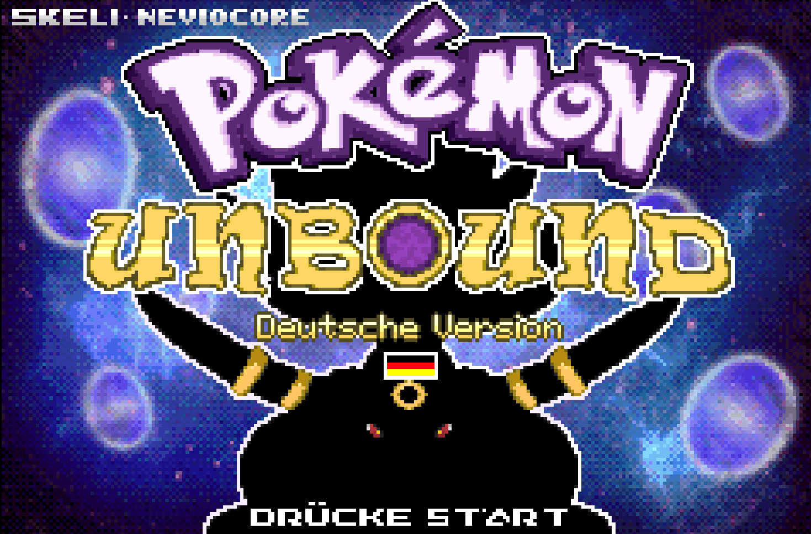
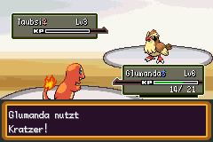
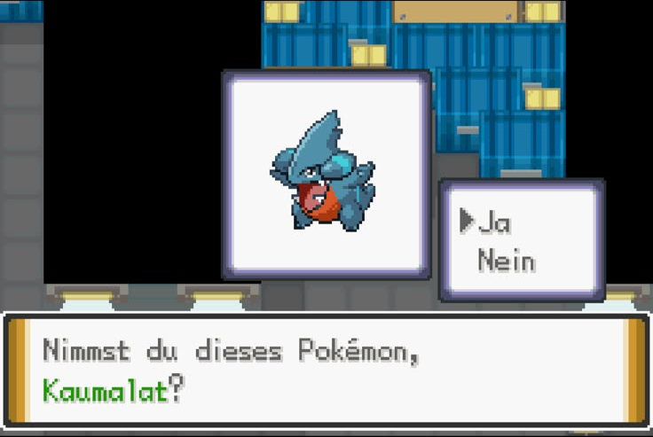
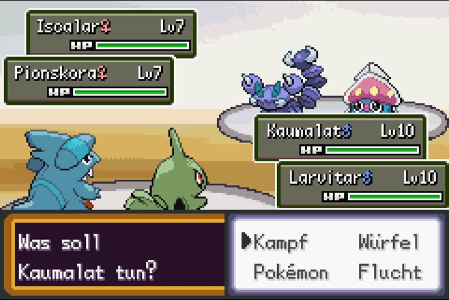
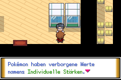
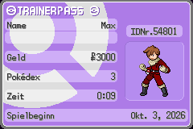
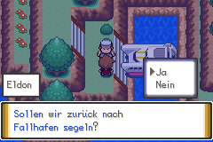
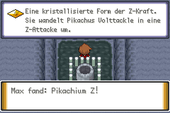

# Pokémon Unbound auf Deutsch – German Patch (Fan-Übersetzung)

**Die Beta ist da!** Spiel Pokémon Unbound auf Deutsch – mit den offiziellen deutschen Pokémon-Begriffen.

·  🧩 **[Im Browser patchen](https://pokemon-unbound-de.github.io/pokemon-unbound-de/)** 
·  👉 **[Download (neueste Beta)](https://github.com/pokemon-unbound-de/pokemon-unbound-de/releases/latest)** 
·  📖 **[Patch-Anleitung](docs/PATCH_ANLEITUNG.md)** 
·  💬 **[Discord](https://discord.gg/fSkhHppgcv)** 
·  🇩🇪 **[Reddit](https://www.reddit.com/r/PokemonUnboundDE/)**

*English below.*

  
  

## In 3 Schritten spielen

1. **[Patch-Seite](https://pokemon-unbound-de.github.io/pokemon-unbound-de/) öffnen** (geht auch am Handy) und deine eigene **Pokémon FireRed (USA), Rev 0** auswählen.
2. **Deutsche ROM erstellen** – die Seite prüft deine ROM, patcht im Browser auf die neueste Beta und kontrolliert das Ergebnis. Deine ROM wird nicht hochgeladen.
3. **Spielen** in deinem Emulator (z. B. mGBA, Delta, RetroArch).

Andere Wege: Auf der [Release-Seite](https://github.com/pokemon-unbound-de/pokemon-unbound-de/releases/latest) gibt es beide `.bps`-Dateien – für **FireRed (USA) Rev 0** (`…_von_firered_usa.bps`) und für **Pokémon Unbound (englisch) v1.0.1** (`pokemon_unbound_de_vX.Y.Z.bps`). Die kannst du z. B. mit [Rom Patcher JS](https://www.marcrobledo.com/RomPatcher.js/) oder Flips anwenden.

Klappt etwas nicht? Meist ist es die falsche Basis-ROM – die [Patch-Anleitung](docs/PATCH_ANLEITUNG.md) zeigt, wie du sie per MD5 prüfst.

> **Keine ROMs hier.** Wir verteilen nur den Patch. Du brauchst deine eigene, legal erworbene Basis-ROM.

## Was ist auf Deutsch?

Story, NPC-Dialoge, Kämpfe, Menüs, Items, Attacken, Fähigkeiten und das Missionsbuch, dazu der Titelbildschirm, die Typ-Symbole, der Trainerpass und weitere Grafiken. Ein Test-Bot hat Intro, Wild- und Trainerkampf, Fang, Doppelkampf, Pokédex, Tasche, PC sowie Speichern und Laden im Emulator durchgespielt – ohne Hänger.

## Es ist eine Beta – das wissen wir schon

- Die Übersetzung ist **KI-gestützt** und automatisch geprüft, aber vieles hat noch kein Mensch gegengelesen.
- Manche Namen sind wegen fester Zeichenlimits gekürzt (z. B. „Unlcht“) – Liste: `ABKUERZUNGEN.md` auf der Release-Seite.
- Basis ist Unbound **v1.0.1**, nicht die aktuelle Version 2.x. Spielstände von 2.x passen nicht.
- **Port auf Unbound 2.1.1.1:** Vorschau Ende Oktober 2026, Beta erst nach dem Stable-Release (siehe [Roadmap](ROADMAP.md)).

Offene Fehler, die wir schon kennen:

<!-- BEKANNT:START (automatisch aus der Fehlerliste, Stand 18.10.2026) -->
- Intro-Einschub (Slide-in) Top Vier v0.1.5: pixelt erst rechts, dann links; …
- Namensbox „Maulwurfmann“ ≠ Trainer „Maulwurf“ (Namensverzeichnis) + Text …
- Pokédex-Größe noch in Fuß (Gewicht seit v0.1.4 in kg)
- Kampf-Intro „Arenaleiter“ bei Frauen (+ Thronfolgerin, Ass-Trainerin)
- EN-Reste in Menü-/Box-Labels: „Cancel“ (PC-Box beim Markieren), „Bag“ (Item …
- UI-Überlauf/abgeschnitten: DexNav („Abbrechen“, eng), Items sortieren, …
- Kampftext-Überlauf bei langen Variablen: Fähigkeitstausch (Feelinara; …
- EN-Reste Kampf/NPC: „A critical hit on …“ (Doppel-/Einzelkampf), Rüpel „No, …
- Pokémon-Namen EN (Hydropi, Geckabor u. a.)
- Statuskürzel EN in Grafik/UI: FNT, SLP, PSN (PAR bleibt, = DE); BRN/FRZ u. a. …
- … und 30 weitere – komplette Liste: angehefteter Beitrag **„📌 Bekannte Fehler“** in [`#beta-bugs`](https://discord.com/channels/1536411206691328088/1561133876318052444) auf [Discord](https://discord.gg/fSkhHppgcv).
<!-- BEKANNT:ENDE -->

Was sich mit jeder Version geändert hat, steht im [CHANGELOG](CHANGELOG.md). Bereits gemeldete Fehler: angehefteter Beitrag „📌 Bekannte Fehler“ in `#beta-bugs` auf Discord.

## Community & Wiki

- **Wiki:** [unboundwiki.de](https://unboundwiki.de) – das deutsche Pokémon-Unbound-Wiki. Es wird von **Fletcher Mops**
  und **Fabian (Vegetarox)** gepflegt – danke!
- **Namensverzeichnis** (Figuren, Orte, Trainerklassen, Begriffe – DE ↔ EN): [docs/NAMENSVERZEICHNIS.md](docs/NAMENSVERZEICHNIS.md)
- **Discord:** [beitreten](https://discord.gg/fSkhHppgcv) · **Reddit:** [r/PokemonUnboundDE](https://www.reddit.com/r/PokemonUnboundDE/)

## Hilf mit – Fehler melden

Du brauchst kein Vorwissen. Spiel einfach und sag uns, was dir auffällt: englischer Text, abgeschnittene Wörter, Text, der aus dem Kasten läuft, oder komische Formulierungen.

- **Discord:** Kanal `#beta-bugs` – [jetzt beitreten](https://discord.gg/fSkhHppgcv)
- **Reddit:** [r/PokemonUnboundDE](https://www.reddit.com/r/PokemonUnboundDE/) – Fragen, Funde, Screenshots
- **GitHub:** [Übersetzungsfehler melden](https://github.com/pokemon-unbound-de/pokemon-unbound-de/issues/new?template=01-uebersetzungsfehler.yml)

Am besten mit: Ort im Spiel + Screenshot + (gern) deinem Textvorschlag.

---

## English

**The German fan translation of Pokémon Unbound is in public beta!** Story, dialogue, battles, menus, items, moves and abilities are in German, using official Pokémon terminology.

**How to play:** open our [patch page](https://pokemon-unbound-de.github.io/pokemon-unbound-de/), select your own legal **Pokémon FireRed (USA) Rev 0** and create the German ROM right in your browser (latest beta, result is checksum-verified, your ROM is not uploaded). Alternatively, download **one** `.bps` patch from the [latest release](https://github.com/pokemon-unbound-de/pokemon-unbound-de/releases/latest) – for **FireRed (USA) Rev 0** or **Pokémon Unbound (EN) v1.0.1** – and apply it with [Rom Patcher JS](https://www.marcrobledo.com/RomPatcher.js/) or Flips. MD5 checksums are in `MD5.txt` and the [patch guide](docs/PATCH_ANLEITUNG.md). **No ROMs are provided.**

**It's a beta:** the translation is AI-assisted and machine-checked (text width, names, control codes, plus an emulator test bot), but much of it hasn't been proofread by humans yet. Some names are shortened due to fixed character limits, and the Pokédex still shows height in feet (weight is in kg since v0.1.4). Known open bugs are pinned in `#beta-bugs` on Discord. Based on Unbound **v1.0.1**, not 2.x; a port to 2.1.1.1 gets a preview in late October 2026 and a beta after the stable release. See the [CHANGELOG](CHANGELOG.md) for what changed.

**Help us:** report anything odd in [Discord](https://discord.gg/fSkhHppgcv) (`#beta-bugs`), on [Reddit](https://www.reddit.com/r/PokemonUnboundDE/) or via [GitHub Issues](https://github.com/pokemon-unbound-de/pokemon-unbound-de/issues/new?template=01-uebersetzungsfehler.yml). German speakers who proofread are especially welcome.

---

## Mehr Bilder

  
  

  
  

  
  

Alle Screenshots stammen aus der deutschen Übersetzung. Hintergrund zur Arbeitsweise: [Release Notes v0.1](docs/RELEASE_NOTES_v0.1.md).

## Rechtliches / Legal

Pokémon Unbound © Skeli. Deutsche Fan-Übersetzung: NevioCore & Community.
Dank an **DMkiller** und **Leitplanke** für technische Hinweise (u. a. Liga-Grafikfehler, Pokédex-Code) sowie an alle Tester*innen.
Pokémon and Pokémon Unbound are owned by their respective rights holders. This is an unofficial, non-commercial fan translation, not affiliated with or endorsed by them. No ROMs, BIOS files, save states or commercial assets are distributed. Details: [docs/LICENSING.md](docs/LICENSING.md) · [docs/LEGAL_NOTICE.md](docs/LEGAL_NOTICE.md)

Mitmachen am Projekt: [CONTRIBUTING.md](CONTRIBUTING.md) · [Roadmap](ROADMAP.md)

<!-- FEHLERLISTE:START (automatisch, Stand 18.10.2026) -->
## Fehlerliste – für Interessierte & Mitentwickler

Alle offenen Punkte mit Nummer und Status: **[docs/BEKANNTE_FEHLER.md](docs/BEKANNTE_FEHLER.md)** (automatisch aus unserer Fehlerliste erzeugt).
<!-- FEHLERLISTE:ENDE -->
