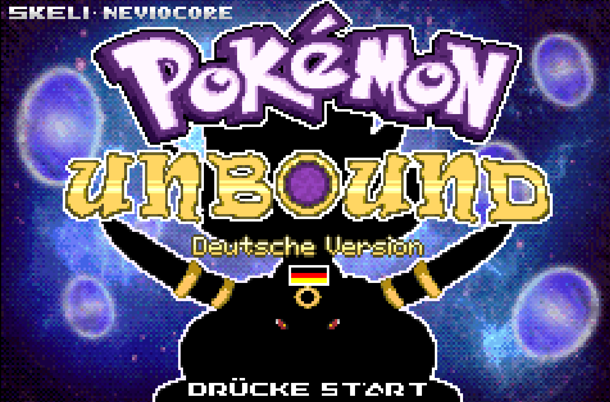
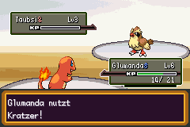
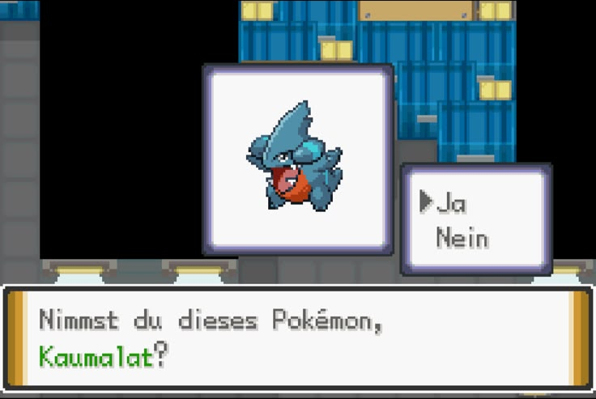
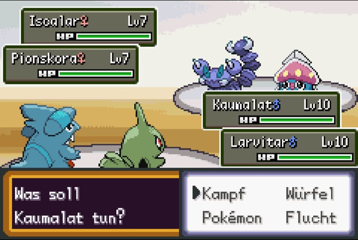
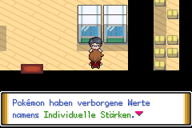
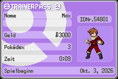
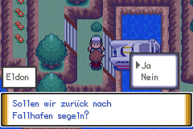
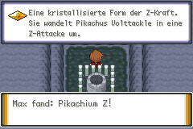

# Pokémon Unbound auf Deutsch – German Patch (Fan-Übersetzung)

> **Das große Update ist da:** **v1.0.0**, die Stable-Fassung für Unbound 1.0.1 mit deutschen Credits im Abspann, und **v2.0.0-beta.3**, die aktuelle Beta für Unbound 2.1.1.1. Alle Neuigkeiten kommen auf unserem [Discord](https://discord.gg/fSkhHppgcv).

## Neu: Beta 3 für Pokémon Unbound 2.1.1.1 (v2.0.0-beta.3)

**Die deutsche Version für die aktuelle Unbound-Version 2.1.1.1 ist als offene Beta da, jetzt in der dritten Fassung.** Rund **93 % der geprüften Textstellen** haben eine deutsche Vorlage. Neu sind unter anderem das MARKT-Schild, die TM-Box mit Attackenbeschreibungen, die wieder in den Kasten passen, und „VM“ statt „HM“ ([CHANGELOG](CHANGELOG.md)). Du findest noch englische Reste, und genau die suchen wir.

·  🧩 **[Port-Beta im Browser patchen](https://pokemon-unbound-de.github.io/pokemon-unbound-de/)** (Auswahl „Port Unbound 2.1.1.1 DE“; geht mit deiner eigenen **Unbound-2.1.1.1-ROM (englisch)** oder mit **Pokémon FireRed (USA) Rev 0**)
·  📦 **[Release v2.0.0-beta.3](https://github.com/pokemon-unbound-de/pokemon-unbound-de/releases/tag/port-v2.0.0-beta.3)** (beide `.bps`-Dateien und Prüfsummen)
·  💬 **[Discord](https://discord.gg/fSkhHppgcv)** (Fehler melden im Forum `#port-bugs`)
·  🛠️ **[Wie wir den Port gebaut haben](docs/PORT_BAU.md)**

Sichere vor dem ersten Start deinen Spielstand, es ist eine Beta. Wie wir die Zahlen gemessen haben, steht [hier](docs/PORT_BAU.md#was-die-zahlen-bedeuten).

## Stable-Linie für Unbound 1.0.1

**Stable v1.0.0 ist da.** Für **Unbound 1.0.1** ist die Übersetzung fertig: deutsche Credits im Abspann und „DAS ENDE“, dazu alle Korrekturen aus v0.1.9 (unter anderem der Neustart nach einem unterbrochenen Speichervorgang und lange Pokémon-Namen in Kampfmeldungen). Dein Spielstand bleibt gültig.

Spiel Pokémon Unbound auf Deutsch – mit den offiziellen deutschen Pokémon-Begriffen, **bis zum Champ durchspielbar**.

·  🧩 **[Im Browser patchen](https://pokemon-unbound-de.github.io/pokemon-unbound-de/)** 
·  👉 **[Download (neueste Stable-Linie, Unbound 1.0.1, v1.0.0)](https://github.com/pokemon-unbound-de/pokemon-unbound-de/releases/tag/v1.0.0)** 
·  📖 **[Patch-Anleitung](docs/PATCH_ANLEITUNG.md)** 
·  💬 **[Discord](https://discord.gg/fSkhHppgcv)** 
·  🇩🇪 **[Reddit](https://www.reddit.com/r/PokemonUnboundDE/)**

*English in short:* a German fan translation of Pokémon Unbound, distributed as a patch only (no ROMs). Patch it in your browser with your own legal ROM. The text is AI-assisted and machine-checked, human review is ongoing. Full English section further below.

  
  

## In 3 Schritten spielen

1. **[Patch-Seite](https://pokemon-unbound-de.github.io/pokemon-unbound-de/) öffnen** (geht auch am Handy) und deine eigene **Pokémon FireRed (USA), Rev 0** auswählen.
2. **Deutsche ROM erstellen** – die Seite prüft deine ROM, patcht im Browser auf die neueste Version und kontrolliert das Ergebnis. Deine ROM wird nicht hochgeladen.
3. **Spielen** in deinem Emulator (z. B. mGBA, Delta, RetroArch).

Andere Wege: Auf der [Release-Seite](https://github.com/pokemon-unbound-de/pokemon-unbound-de/releases/latest) gibt es beide `.bps`-Dateien – für **FireRed (USA) Rev 0** (`…_von_firered_usa.bps`) und für **Pokémon Unbound (englisch) v1.0.1** (`pokemon_unbound_de_vX.Y.Z.bps`). Die kannst du z. B. mit [Rom Patcher JS](https://www.marcrobledo.com/RomPatcher.js/) oder Flips anwenden.

Klappt etwas nicht? Meist ist es die falsche Basis-ROM – die [Patch-Anleitung](docs/PATCH_ANLEITUNG.md) zeigt, wie du sie per MD5 prüfst.

> **Keine ROMs hier.** Wir verteilen nur den Patch. Du brauchst deine eigene, legal erworbene Basis-ROM.

## Was ist auf Deutsch?

Story, NPC-Dialoge, Kämpfe, Menüs, Items, Attacken, Fähigkeiten und das Missionsbuch, dazu der Titelbildschirm, die Typ-Symbole, der Trainerpass und weitere Grafiken. Ein Test-Bot hat Intro, Wild- und Trainerkampf, Fang, Doppelkampf, Pokédex, Tasche, PC sowie Speichern und Laden im Emulator durchgespielt – ohne Hänger.

## Stable v1.0.0 – Stand

- **Bis zum Champ durchspielbar** – komplett getestet von **NevioCore** und **DMkiller**, mit deutschen Credits im Abspann für alle, die mitgeholfen haben.
- **Fehler gefunden?** Melde sie auf dem [Discord](https://discord.gg/fSkhHppgcv). Wir beheben sie weiter in Updates. Wichtig sind uns vor allem englische Reste, Text, der aus dem Fenster läuft, Grammatik und Umlaute, Grafikfehler und Absturz- oder Speicherprobleme. Stil- und Begriffswünsche sammeln wir gern für spätere Versionen.

- Die Übersetzung ist **KI-gestützt** und automatisch geprüft, aber vieles hat noch kein Mensch gegengelesen.
- Manche Namen sind wegen fester Zeichenlimits gekürzt (z. B. einzelne Item-Namen) – Liste: `ABKUERZUNGEN.md` auf der Release-Seite.
- Basis ist Unbound **v1.0.1**, nicht die aktuelle Version 2.x. Spielstände von 2.x passen nicht.
- **Port auf Unbound 2.1.1.1:** Seit dem 18.11.2026 gibt es eine offene Beta, jetzt in der Fassung **v2.0.0-beta.3** (siehe oben), siehe auch [Roadmap](ROADMAP.md). Die Basis dieser Stable-Linie bleibt Unbound 1.0.1.

Offene Fehler, die wir schon kennen:

<!-- BEKANNT:START (automatisch aus der Fehlerliste, Stand 27.11.2026) -->
- REGRESSION/Rest von #56/#113 in v1.0.0: „A critical hit on Pokémon]!“ EN …
- Credits & Ende: „Pokémon Unbound Deutsche Edition“; Nevio als Hauptlokalisator … *(behoben, kommt mit dem nächsten Release)*
- Pokédex-Einträge nicht kanonisch („Dieses Meeres-Pokémon …“ bei Dragoran) *(eigener Track)*
- Kanon-Abweichungen Items/Attacken (z. B. Glare „Giftblick“ ≠ „Schlangenblick“, …
- Dialogwerkstatt: Spielbegriffe noch änderbar, Vorschau doppelt *(eigener Track)*
- Port: Kampf-Healthboxen zerrupft (Oberkante der Namen abgeschnitten, Level … *(behoben, kommt mit dem nächsten Release)*
- MENUEFENSTER_ZU_SCHMAL in 1.0.1 *(behoben, kommt mit dem nächsten Release)*
- Ankauf abgelehnt EN: „Item]? Oh, no. I can't buy that.“ (Laden, Verkaufen …
- Weitere Karten mit Map-Skript-Tabelle voller Fremdbytes
- Kampf-Intro „Arenaleiter“ bei Frauen (+ Thronfolgerin, Ass-Trainerin) *(folgt mit dem Port 2.1.1.1)*
- … und 8 weitere – komplette Liste: angehefteter Beitrag **„📌 Bekannte Fehler“** in [`#bekannte-fehler`](https://discord.com/channels/1536411206691328088/1569384805743992882) auf [Discord](https://discord.gg/fSkhHppgcv).
<!-- BEKANNT:ENDE -->

Was sich mit jeder Version geändert hat, steht im [CHANGELOG](CHANGELOG.md). Bereits gemeldete Fehler: angehefteter Beitrag „📌 Bekannte Fehler“ in `#bekannte-fehler` auf Discord.

## Community & Wiki

- **Wiki:** [unboundwiki.de](https://unboundwiki.de) – das deutsche Pokémon-Unbound-Wiki. Es wird von **Fletcher Mops**
  und **Fabian (Vegetarox)** gepflegt – danke!
- **Namensverzeichnis** (Figuren, Orte, Trainerklassen, Begriffe – DE ↔ EN): [docs/NAMENSVERZEICHNIS.md](docs/NAMENSVERZEICHNIS.md)
- **Discord:** [beitreten](https://discord.gg/fSkhHppgcv) · **Reddit:** [r/PokemonUnboundDE](https://www.reddit.com/r/PokemonUnboundDE/)

## Hilf mit – Fehler melden

Du brauchst kein Vorwissen. Spiel einfach und sag uns, was dir auffällt: englischer Text, abgeschnittene Wörter, Text, der aus dem Kasten läuft, oder komische Formulierungen.

- **Discord:** Forum `#stable-bugs` (Stable 1.0.1) oder `#port-bugs` (Port-Beta 2.1.1.1), ein Thread pro Fund – [jetzt beitreten](https://discord.gg/fSkhHppgcv)
- **Reddit:** [r/PokemonUnboundDE](https://www.reddit.com/r/PokemonUnboundDE/) – Fragen, Funde, Screenshots
- **GitHub:** [Übersetzungsfehler melden](https://github.com/pokemon-unbound-de/pokemon-unbound-de/issues/new?template=01-uebersetzungsfehler.yml)

Am besten mit: Ort im Spiel + Screenshot + (gern) deinem Textvorschlag.

---

## English

**The German fan translation of Pokémon Unbound is in public beta!** Story, dialogue, battles, menus, items, moves and abilities are in German, using official Pokémon terminology.

**How to play:** open our [patch page](https://pokemon-unbound-de.github.io/pokemon-unbound-de/), select your own legal **Pokémon FireRed (USA) Rev 0** and create the German ROM right in your browser (latest beta, result is checksum-verified, your ROM is not uploaded). Alternatively, download **one** `.bps` patch from the [latest release](https://github.com/pokemon-unbound-de/pokemon-unbound-de/releases/latest) – for **FireRed (USA) Rev 0** or **Pokémon Unbound (EN) v1.0.1** – and apply it with [Rom Patcher JS](https://www.marcrobledo.com/RomPatcher.js/) or Flips. MD5 checksums are in `MD5.txt` and the [patch guide](docs/PATCH_ANLEITUNG.md). **No ROMs are provided.**

**It's a beta:** the translation is AI-assisted and machine-checked (text width, names, control codes, plus an emulator test bot), but much of it hasn't been proofread by humans yet. Some names are shortened due to fixed character limits. The Pokédex shows height in meters since v0.1.6 (weight has been in kg since v0.1.4). Known open bugs are pinned in `#bekannte-fehler` on Discord. This stable line is based on Unbound **v1.0.1**. **Stable v1.0.0 is out for Unbound 1.0.1, and the open beta for Unbound 2.1.1.1 is now at v2.0.0-beta.3.** About 93 % of the checked text lines of the port have a German version; the rest follows in further betas. Patch it in the [browser](https://pokemon-unbound-de.github.io/pokemon-unbound-de/) (choose "Port Unbound 2.1.1.1 DE") with your own legal Unbound 2.1.1.1 (EN) or FireRed (USA) Rev 0 ROM, or take a `.bps` from the [release](https://github.com/pokemon-unbound-de/pokemon-unbound-de/releases/tag/port-v2.0.0-beta.3). Back up your save first. How it was built: [docs/PORT_BAU.md](docs/PORT_BAU.md). See the [CHANGELOG](CHANGELOG.md) for what changed.

**Help us:** report anything odd in [Discord](https://discord.gg/fSkhHppgcv) (`#stable-bugs` or `#port-bugs`, English is fine), on [Reddit](https://www.reddit.com/r/PokemonUnboundDE/) or via [GitHub Issues](https://github.com/pokemon-unbound-de/pokemon-unbound-de/issues/new?template=01-uebersetzungsfehler.yml). German speakers who proofread are especially welcome.

---

## Mehr Bilder

  
  

  
  

  
  

Alle Screenshots stammen aus der deutschen Übersetzung. Hintergrund zur Arbeitsweise: [Release Notes v0.1](docs/RELEASE_NOTES_v0.1.md).

## Technik: Praxisbericht und Pipeline „Glyphwerk“ (bald öffentlich)

Beim Übersetzen eines großen GBA-ROM-Hacks stößt man auf immer dieselben Hürden: zu wenig Freispeicher, Zeiger mitten in Texten, Pixelbreiten, Puffer-Codes. Was bei uns funktioniert hat, mit Zahlen: **[docs/PRAXISBERICHT.md](docs/PRAXISBERICHT.md)** (*GBA ROM translation – lessons learned*) (für andere ROM-Hacker, ohne ROM-Daten und ohne Spieltext).

Die dazugehörige Übersetzungs-Pipeline heißt **Glyphwerk** (GBA ROM Translation Pipeline: Textkodierung, Zeigerscan, Freispeicher, Prüfungen vor dem Build, Test-Bot, Patch-Werkzeug). Sie ist noch **privat** und wird nach der Beta öffentlich. *Glyphwerk, our GBA ROM translation pipeline, will be published after the beta.*

## Rechtliches / Legal

Pokémon Unbound © Skeli. Deutsche Fan-Übersetzung: NevioCore & Community.
Dank an **DMkiller** und **Leitplanke** für technische Hinweise (u. a. Liga-Grafikfehler, Pokédex-Code) sowie an alle Tester*innen.
Pokémon and Pokémon Unbound are owned by their respective rights holders. This is an unofficial, non-commercial fan translation, not affiliated with or endorsed by them. No ROMs, BIOS files, save states or commercial assets are distributed. Details: [docs/LICENSING.md](docs/LICENSING.md) · [docs/LEGAL_NOTICE.md](docs/LEGAL_NOTICE.md)

Mitmachen am Projekt: [CONTRIBUTING.md](CONTRIBUTING.md) · [Roadmap](ROADMAP.md)

<!-- FEHLERLISTE:START (automatisch, Stand 27.11.2026) -->
## Fehlerliste – für Interessierte & Mitentwickler

Alle offenen Punkte mit Nummer und Status: **[docs/BEKANNTE_FEHLER.md](docs/BEKANNTE_FEHLER.md)** (automatisch aus unserer Fehlerliste erzeugt).
<!-- FEHLERLISTE:ENDE -->

<!-- MEILENSTEINE:START (automatisch, Stand 27.11.2026) -->
## Meilensteine

| Schritt | Stand |
|---|---|
| v1.0.0 Stable | ✔ veröffentlicht |
| Pokédex-Einträge offiziell (#117) | eigener Track, schrittweise |
| Port auf Unbound 2.1.1.1 | offene Beta v2.0.0-beta.2 · Fehler aus der Beta und letzte englische Texte folgen in weiteren Betas |

## Mitmachen

Wir suchen weiter **Entwickler, Tester und Talente** (Grafik, Texte, ROM-Hacking). Komm auf unseren Discord: https://discord.gg/fSkhHppgcv
<!-- MEILENSTEINE:ENDE -->
